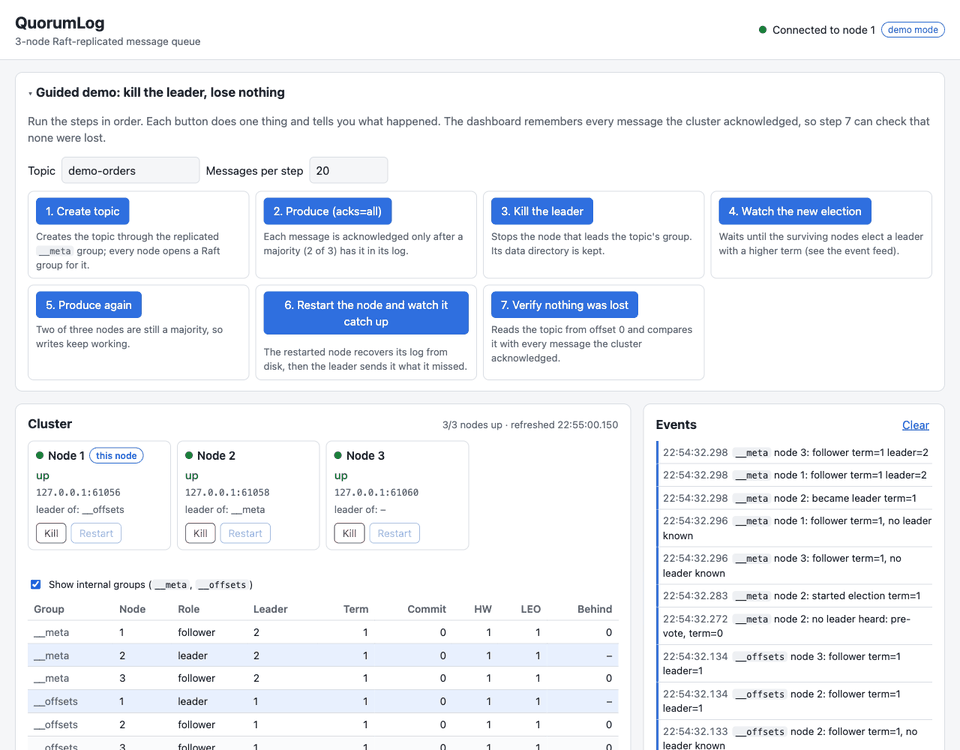

# QuorumLog

**A 3-node, Raft-replicated message queue in Go: topics, durable produce/consume, consumer-group offsets, idempotent
producers, automatic leader failover, and a live dashboard where you can kill the leader and watch the cluster recover
without losing acknowledged messages.**

[](https://github.com/Rahul-Nikhate/quorumlog/actions/workflows/ci.yml)

<!-- Replace with a recording of the guided demo (kill leader → election → catch-up → verify). -->


**Live demo:** _coming soon: `https://<your-service>.onrender.com` (free instance; the first request after idling
takes about a minute, and demo data resets on restart)._

Raft (elections, replication, snapshots, ReadIndex) and the segmented on-disk log are written from scratch. The only
module dependencies are `golang.org/x/sys` plus test-only libraries.

---

## Try it in 60 seconds

```sh
git clone https://github.com/Rahul-Nikhate/quorumlog.git && cd quorumlog
go run ./cmd/qlogd --demo          # 3 Raft nodes in one process
open http://localhost:8080         # dashboard
```

On the dashboard, run the **Guided demo**:

1. create a topic,
2. produce with `acks=all`,
3. kill the leader,
4. watch the new election,
5. produce again,
6. restart the node and watch it catch up,
7. verify that every acknowledged message is still there.

Or use the API directly:

```sh
curl -s -XPOST localhost:8080/v1/topics -d '{"name":"orders"}'
curl -s -XPOST localhost:8080/v1/topics/orders/messages \
     -d '{"messages":[{"key":"k1","value":"hello"}],"acks":"all","producer_id":"p-1","sequence":0}'
curl -s 'localhost:8080/v1/topics/orders/messages?offset=0&max=10'
curl -s localhost:8080/v1/cluster
```

Prefer containers? `docker build -t quorumlog . && docker run --rm -p 8080:8080 quorumlog` starts the same demo, and
`docker compose -f deploy/docker-compose.yml up -d --build` starts three real nodes on ports 8081–8083
([DEPLOY.md](docs/DEPLOY.md)).

## Features

- **Replication with Raft.** Elections use randomized timeouts, pre-vote and check-quorum. Replication uses fast log
  backup and the Figure-8 commit rule, and a new leader appends a no-op entry. Also implemented: snapshots, ReadIndex
  and leadership transfer.
- **Durable, segmented log.** Records are CRC-32C-checked and stored in append-only segments, with a sparse mmap'd
  offset/time index. Three fsync policies: `always` (group commit), `interval` and `never`. Recovery after a crash cuts
  a torn tail. Retention is implemented in the log library (the server does not schedule it).
- **Produce semantics.** `acks=all` waits for a majority commit, `acks=leader` only for the leader's log. Consumers
  read only up to the high watermark, so they only ever see committed data.
- **Idempotent producers.** Duplicates are detected by producer id + sequence, so a retry after a timeout or a failover
  does not append a duplicate.
- **Consumer-group offsets** are stored in a replicated `__offsets` Raft group.
- **Any node accepts requests.** Writes *and reads* sent to a follower are forwarded to the leader (`X-QL-Leader`,
  `X-QL-Forwarded`), at most one hop. Reads go to the leader because only the leader can serve a linearizable read
  (it confirms its leadership with a Raft ReadIndex round first).
- **Long-poll consume.** `GET …/messages?wait_ms=` waits until new data is committed.
- **Live dashboard.** It is embedded in the binary and has no build step. It shows the cluster, per-group
  role/term/commit/HW/LEO, an election feed, produce and tail panels, consumer offsets, and Kill/Restart buttons in
  demo mode.
- **Deployable for free.** Multi-stage distroless image, Docker Compose, Render Blueprint, and a guide for an Oracle
  Always Free VM ([DEPLOY.md](docs/DEPLOY.md)).

## Architecture

```
                       HTTP/JSON (any node)                                   ┌──────────────────────────┐
  client / qlog CLI ───────────────────────────────┐                          │ dashboard (embedded JS)  │
  dashboard (browser)                              │                          └────────────┬─────────────┘
                                                   ▼                                       │ same API
        ┌──────────────── node 1 ────────────────┐   ┌─ node 2 (leader of "orders") ─┐   ┌─ node 3 ─┐
        │ httpapi: /v1/*  ── follower? forward ──┼──▶│ httpapi                       │   │   ...    │
        │ cluster: __meta (topics), __offsets    │   │ partition "orders"            │   │          │
        │ partition "orders" (Raft follower)     │   │  produce → Raft propose       │   │          │
        │   raft.Node ◀───────────────┐          │   │  commit → advance HW → acks   │   │          │
        │   raftlog: segmented log    │          │   │  fetch ≤ HW (long-poll)       │   │          │
        └──────────────┬──────────────┼──────────┘   └───────────────┬───────────────┘   └────┬─────┘
                       │              └── Raft over TCP: one connection per peer pair,  ──────┘
                       │                  length-prefixed frames, groups multiplexed by id
                       ▼
        data-dir/  orders/00000000000000000000.log   (record batches, CRC-32C)
                          00000000000000000000.index (sparse offset → position, mmap)
                          raft/hardstate              (term, vote: tmp → fsync → rename)
```

Each topic has one partition, and each partition is a Raft group on all three nodes. `__meta` replicates the topic
list. `__offsets` replicates consumer-group offsets. See [DESIGN.md](docs/DESIGN.md) for the write path, the read
path and a failover walkthrough.

## Why it's correct

Each guarantee is backed by a test that can fail:

| Guarantee | How it's tested |
|---|---|
| Raft safety: election safety, log matching, leader completeness | `internal/raft/rafttest`: 6.5840-style suites (`TestFigure8Unreliable`, `TestChurn`, `TestBackup`, `TestReadIndexChaos`, …) on a deterministic, fault-injecting network. They run over many seeds, and any failure can be replayed from its seed. |
| The checkers can actually fail | `internal/raft/negative_test.go`: each test re-enables one classic Raft bug through a test-only knob and asserts that the invariant checkers catch it within a bounded number of seeds. |
| No acknowledged write is lost on power failure | `internal/log/crash_test.go`: a fault-injecting FS drops unsynced writes and tears partial pages. After recovery the log holds exactly the synced prefix and never loses a durable batch (10,000 iterations per test in [RESULTS.md](docs/RESULTS.md)). |
| Corrupt bytes are never served | Fuzz targets (`FuzzOpenCorrupted`, `FuzzRecords`, …) and CRC-32C validation. Inputs the fuzzer found are kept as regression cases. |
| Log behaves like a simple model | Property tests (`rapid`) compare the segmented log with an in-memory model, on both the real FS and FaultFS. |
| Idempotent producer across failover | `internal/partition`: `TestIdempotentRetryAcrossFailover`, `TestMessageAPIIdempotentProducer` (string producer ids, duplicate → original offsets, `OUT_OF_ORDER_SEQUENCE`), `TestTruncationRebuildsProducerState`. |
| Produce + read is linearizable | `test/porcupine`: concurrent `produce(acks=all)` / read histories (20 seeds by default, `QLOG_PORCUPINE_HISTORIES=N` for more) on a 3-replica partition while a nemesis isolates nodes, partitions the network and crash-restarts replicas (losing unsynced writes), checked with the [Porcupine](https://github.com/anishathalye/porcupine) linearizability checker. Two **negative controls** must be flagged as *not* linearizable: reads served from a follower's local log, and an `acks=leader` write lost by a failover. |
| End to end: kill the leader, lose nothing | `test/e2e`: 3 nodes over real HTTP + TCP with temp dirs. Four idempotent producers send 240 messages with `acks=all` while the topic's leader is killed and later restarted (clients retry on errors). Consuming everything must find every acknowledged message at its acknowledged offset, no duplicates, and the identical log on all three nodes. A second test commits a consumer-group offset and kills the `__offsets` leader twice; the offset must survive. |

CI runs `gofmt`, `go vet`, `go test -race ./...`, `go build` and `docker build` on every push.

## CS concepts showcased

| Area | Concept | Where |
|---|---|---|
| OS | `fsync`/`fdatasync`, `F_FULLFSYNC` on macOS, directory fsync after rename/create | `internal/fs/osfs*.go`, `internal/log/log.go` |
| OS | Page cache vs durability, group commit (one fsync for many writers) | `internal/log/flusher.go`, `internal/log/log.go` |
| OS | `mmap`'d index files | `internal/log/index_unix.go` |
| OS | Fault injection: torn writes, lost unsynced data | `internal/fs/faultfs.go` |
| DBMS | Write-ahead log, segment files, sparse index | `internal/log` |
| DBMS | Crash recovery: CRC-32C, truncating a torn tail, checkpoints | `internal/log/log.go`, `internal/log/batch.go` |
| DBMS | Atomic metadata update (tmp → fsync → rename → fsync dir) | `internal/raft/hardstate.go` |
| DBMS | Idempotence and deduplication (producer id + sequence) | `internal/partition/producerstate.go` |
| CN | TCP framing (length-prefixed), connection per peer, reconnect with backoff + jitter | `internal/raft/transport/tcp.go` |
| CN | HTTP/JSON API, long-polling, timeouts, leader forwarding | `internal/httpapi` |
| Distributed systems | Raft: elections, pre-vote, check-quorum, replication, snapshots | `internal/raft/node.go`, `internal/raft/log.go` |
| Distributed systems | Linearizable reads with ReadIndex | `internal/raft/readindex.go` |
| Distributed systems | Replicated metadata and offsets (`__meta`, `__offsets`) | `internal/cluster` |
| Distributed systems | Commit index vs high watermark, `acks=all` vs `acks=leader` | `internal/partition` |
| Testing | Deterministic simulation, property tests, fuzzing, linearizability checking | `internal/raft/rafttest`, `internal/log/*_test.go`, `test/porcupine` |

## API

JSON over HTTP on every node. Errors look like `{"error":"…","code":"NOT_LEADER|NOT_FOUND|BAD_REQUEST|TIMEOUT|UNAVAILABLE|OUT_OF_ORDER_SEQUENCE"}`.
The full contract is in [SCOPE.md](docs/SCOPE.md).

| Method & path | Body / query | Response |
|---|---|---|
| `GET /v1/health` | – | `{"node_id":1,"ok":true}` |
| `GET /v1/cluster` | – | nodes (up/down), groups (role, leader, term, commit, high_watermark, log_end_offset), recent events |
| `POST /v1/topics` | `{"name":"orders"}` | `201 {"name":"orders"}` (`200` if it already exists) |
| `GET /v1/topics` | – | `{"topics":["orders"]}` |
| `POST /v1/topics/{topic}/messages` | `{"messages":[{"key":"k","value":"v"}],"acks":"all"\|"leader","producer_id":"p-1","sequence":0}` | `{"base_offset":42,"last_offset":42,"duplicate":false}` |
| `GET /v1/topics/{topic}/messages` | `?offset=0&max=100&wait_ms=0` | `{"messages":[…],"next_offset":43,"high_watermark":43}` |
| `POST /v1/groups/{group}/offsets` | `{"topic":"orders","offset":43}` | `{"ok":true}` |
| `GET /v1/groups/{group}/offsets` | `?topic=orders` | `{"group":"g","topic":"orders","offset":43}` (`-1` if none) |
| `POST /v1/demo/nodes/{id}/kill` · `…/restart` | – (demo mode only) | `{"ok":true}` |
| `GET /metrics` | – | plain-text counters |

Offsets are 0-based (internally Raft index = offset + 1). The election marker each new leader writes also occupies an
offset (never returned to consumers), so a new topic's first message is usually at offset 1 and offsets can have gaps,
as with Kafka's control records: always continue from `next_offset`. `high_watermark` is the offset after the last
committed entry. A fetch returns at most `max` messages and about 1 MiB of keys and values (but always at least one
message), so it can return fewer messages than asked for even when more are committed. Topic names are unique
ignoring case (`Orders` is refused once `orders` exists), because each topic's directory is named after it.

## Results

All numbers are measured, with the hardware, OS and exact command listed next to them. See
**[docs/RESULTS.md](docs/RESULTS.md)**. It covers storage microbenchmarks (append/fsync/group commit/read), crash-test
iteration counts and, as they are measured, end-to-end throughput/latency (`qlog bench`) and failover timings.

## Project layout

```
cmd/qlogd/            server: one node, or --demo (3 nodes in one process)
cmd/qlog/             CLI: topics create|list, produce, consume, status, bench
internal/fs/          real + fault-injecting file system
internal/log/         segmented log, sparse mmap index, fsync policies, crash recovery, retention
internal/raft/        Raft state machine (no I/O), transport/ (TCP + in-memory), rafttest/ (sim harness)
internal/raftlog/     the segmented log as Raft's LogStore
internal/partition/   per-group driver: produce/acks, high watermark, long-poll fetch, idempotent producer
internal/cluster/     node wiring: __meta topics, __offsets, one Raft group per topic, events
internal/httpapi/     HTTP/JSON API, leader forwarding
internal/dashboard/   embedded single-page dashboard
test/e2e/  test/porcupine/
deploy/docker-compose.yml  Dockerfile  render.yaml  .github/workflows/ci.yml
docs/                 SCOPE, DESIGN, DEPLOY, RESULTS, IMPLEMENTATION_NOTES
```

## Limitations and non-goals

QuorumLog is a teaching-sized system and leaves these out on purpose:

- **One partition per topic.** The replication factor is the cluster size (3). There is no partitioning, placement or
  rebalancing.
- **Fixed membership.** The three nodes are configured at startup, and adding or removing a node at runtime is not
  supported.
- **No Kafka wire protocol.** The API is HTTP/JSON, so Kafka clients don't work with it.
- **No consumer-group protocol.** There is no join, sync, heartbeat or partition assignment. A group is just a name
  with a committed offset per topic.
- **No authentication or TLS between nodes.** Put a reverse proxy in front for HTTPS ([DEPLOY.md](docs/DEPLOY.md)).
- **Demo mode is a demo.** Three nodes in one process share one machine and one disk, so they fail together. On
  Render's free tier, the data is lost whenever the instance restarts. The Kill/Restart endpoints
  (`/v1/demo/nodes/{id}/…`) have no authentication, so anyone who can reach a public demo can stop its nodes. With all
  three stopped, `/v1/health` answers 503, and a platform health check (Render's) may then restart the instance.
- **Idempotence covers recent retries only.** Each producer id remembers its last 5 batches (Kafka's window), and
  producer ids are 63-bit hashes of the id string. A retry of an older batch gets `OUT_OF_ORDER_SEQUENCE`, and a
  produce without `producer_id` that is retried after `TIMEOUT`/`UNAVAILABLE` can be written twice.
- **Not tuned for throughput.** There is no zero-copy `sendfile` path, and messages are JSON over HTTP.

## License

[MIT](LICENSE) © 2026 Rahul Nikhate
